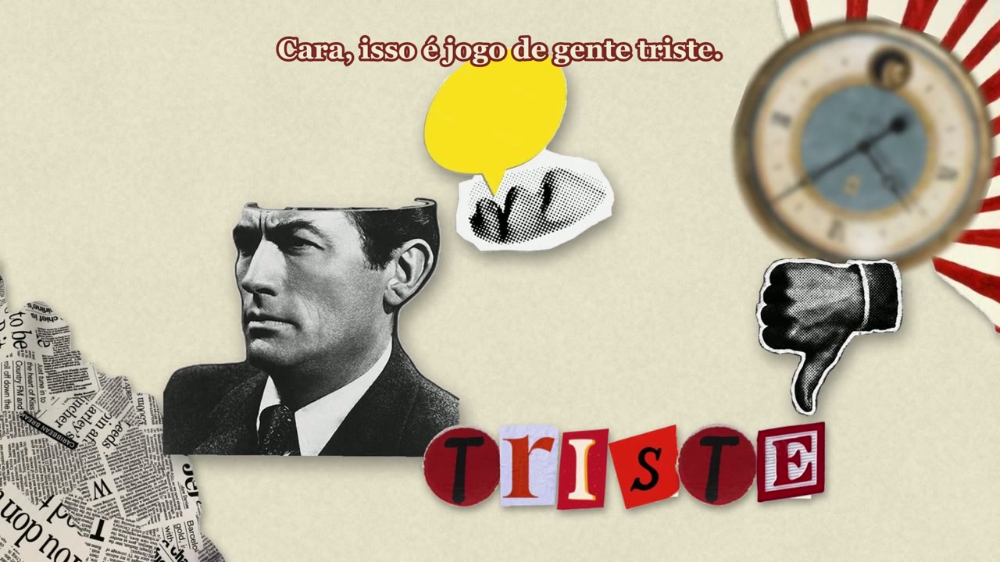
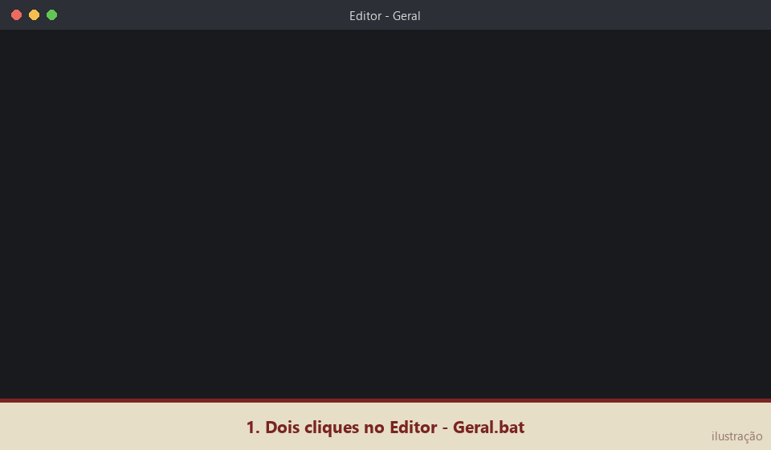
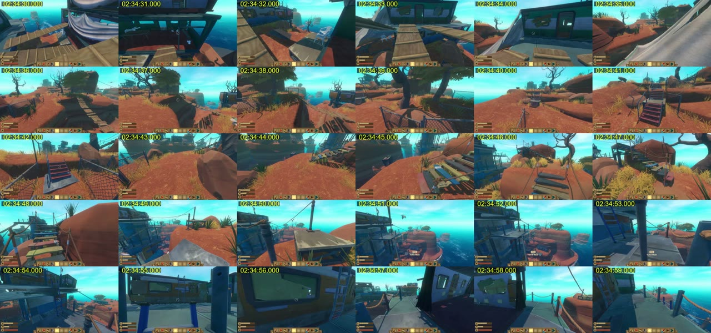

# edicao-rik — um editor de vídeo que aprende o seu estilo

Um editor de vídeo feito com o [Claude Code](https://claude.com/claude-code): a IA **assiste e ouve a gravação inteira**, monta a história, escreve a lista de edição e **renderiza o vídeo de verdade** com ffmpeg, usando as ferramentas em Python desta pasta.

Ela não edita de um jeito genérico: **você ensina os seus estilos**. Cada estilo vira um arquivo de regras, construído aos poucos, vídeo a vídeo: o que fazer, o que nunca fazer, que música usar, qual o ritmo dos cortes. Tudo fica escrito, então o editor não erra a mesma coisa duas vezes.

> Eu programei as ferramentas e ensinei o editor a usar elas.

<p align="center">
  <a href="https://github.com/GustavoDiforwil/Editor-de-video-com-IA-GUS/releases/latest/download/Instalar-Editor-IA.bat"></a>
</p>

<p align="center"><b>1.</b> Baixe o <code>Instalar-Editor-IA.bat</code> &nbsp;·&nbsp; <b>2.</b> Dê dois cliques &nbsp;·&nbsp; <b>3.</b> Escolha Claude, Gemini ou sem IA</p>



*Frame de um vídeo narrado editado do zero pelo projeto: colagem de papel, palavra forte em letras recortadas, peças que tremem tipo stop-motion e legenda que acende a palavra dita. Tudo gerado em Python (`colagem.py` + `render_narrado.py`).*

## Três jeitos de usar

O instalador pergunta qual você quer. Dá pra trocar depois rodando ele de novo.

| | **1. Claude Code** (recomendado) | **2. Gemini CLI** (alternativa) | **3. Sem IA** (grátis e offline) |
|---|---|---|---|
| O que faz | Tudo: entende a cena e a piada, monta a história, aprende o seu estilo | O mesmo processo, com as mesmas regras e comandos | Corta pausas e tempo sem fala, nivela o volume, põe música |
| Qualidade | A melhor | Funciona, mas erra e inventa mais: confira sempre | Corte limpo, sem criatividade |
| Aprende estilos | Sim | Sim | Não |
| Custo | Plano pago do Claude (Pro/Max) ou API | Costuma ter cota grátis com conta Google (confira na página oficial) | Grátis |
| Como abre | `Editor - Geral.bat` | `Editor - Geral.bat` | Arraste o vídeo no `EDITAR-SEM-IA.bat` |

As ferramentas em Python são as mesmas nos três: o que muda é quem decide os cortes.

## Começa sem estilo nenhum

O repositório vem sem estilos: quem cria é você. Dê dois cliques no **`Editor - Geral.bat`**, explique como você gosta que seus vídeos sejam editados e dê um nome ao estilo. O editor então:

1. cria `estilos/<nome>.md`, com um **NÚCLEO** fixo (os ~10 pontos essenciais que você ensinou) e espaço pra lições e notas;
2. cria o atalho `Editor - <Nome>.bat`, que abre o editor já carregando só aquele estilo;
3. cria `referencias/<nome>.md`, um caderno de referências só desse estilo;
4. registra o estilo no `CLAUDE.md`.



*Ilustração (não é uma gravação de tela) de como é usar: ensinar um estilo no Geral, depois mandar o vídeo no atalho do estilo.*

Depois é só abrir o atalho do estilo e mandar o vídeo. As ferramentas já cobrem três tipos de vídeo: **gameplay cômico** com amigos, **vídeo narrado** em colagem de papel e **montagem** sincronizada com a música.

## Como funciona

1. **Ouvir tudo:** transcreve a gravação inteira com o Whisper, com o tempo de cada palavra.
2. **Ver tudo:** tira 1 frame por segundo em folhas de 30 frames (4 por segundo nos momentos-chave). É assim que a IA "assiste":

    

    *30 segundos de gameplay numa folha só: cada quadro tem o tempo exato, então a IA sabe onde cortar.*
3. **Mapa:** anota os momentos bons com tempo e as piadas que se repetem (`projetos/<video>/mapa.md`).
4. **História:** abertura forte, arcos com setup → payoff, clímax e final, nunca uma lista de clipes.
5. **EDL e render:** a edição vira um arquivo Python com cada plano, zoom, música e efeito; o renderer gera o vídeo e nivela o áudio.
6. **Revisão e lição:** confere o resultado e registra no máximo 1–2 lições novas no estilo.

### Por que ele não esquece

A IA não lembra de uma conversa pra outra, então a memória dela são os arquivos. E cada coisa fica no seu lugar:

```text
edicao-rik/
├─ INSTALAR.bat            ← instalador: pergunta Claude, Gemini ou sem IA
├─ instalador/             ← o instalador de um arquivo só (o que o botão de download baixa)
├─ CLAUDE.md               ← regras que valem pra qualquer vídeo (o GEMINI.md importa este)
├─ Editor - Geral.bat      ← onde você conversa e ensina estilos novos
├─ EDITAR-SEM-IA.bat       ← modo sem IA: arraste o vídeo em cima
├─ Editor - <Estilo>.bat   ← criado pra cada estilo: abre já carregando só ele
├─ estilos/                ← um arquivo por estilo: NÚCLEO fixo + lições (máx. 10) + notas por jogo
├─ referencias/            ← um caderno de referências por estilo, pra não misturar
├─ projetos/<video>/       ← tudo de um vídeo: transcrição, frames, mapa, EDL, render (fora do repositório)
├─ ferramentas/            ← as ferramentas em Python
├─ exemplos/               ← duas EDLs reais, pra ver o formato
├─ .claude/skills/         ← comandos /editar-video, /revisar-edicao, /estudar-referencia (Claude Code)
└─ .gemini/commands/       ← os mesmos comandos, no formato do Gemini CLI
```

- O **NÚCLEO** de cada estilo é fixo: só você muda. Lição nova vira ajuste fino e nunca enterra o básico.
- O atalho de cada estilo carrega só aquele estilo: as regras de um tipo de vídeo não contaminam outro.
- Das referências, a IA registra o **padrão** (ritmo, estrutura, por que a piada funciona), nunca a piada pra copiar.

## As ferramentas

Todas em [`ferramentas/`](ferramentas/), documentadas em [`ferramentas/LEIA.md`](ferramentas/LEIA.md) e na docstring de cada arquivo.

| Etapa | Ferramentas | O que fazem |
|---|---|---|
| Ouvir | `transcribe_range.py`, `transcribe_windows.py`, `ilhas_fala.py`, `dump_transcript.py`, `words_range.py` | Transcrição local com faster-whisper (blocos de 60s, retoma se cair); separa fala de respiração cruzando o volume (RMS a cada 10 ms) com as palavras |
| Ver | `frames_windows.py`, `find_peaks.py`, `conferir_render.py` | Folhas de frames com timestamp; triagem de gritos/risadas por pico relativo à mediana local; conferência do render plano a plano |
| Editar | `render_shots.py`, `render_narrado.py`, `colagem.py`, `colagem_kit.py`, `recortar_assets.py`, `render_montagem.py` | Renderers por tipo de vídeo. Planos em `.mkv` com áudio PCM e `concat` sem recodificar; voz com `dynaudnorm` + compressor, música com ducking (`sidechaincompress`) e `loudnorm`; cache de planos por assinatura; colagem de papel em Pillow com poses de stop-motion e paralaxe; vozes de personagem com `asetrate` + `atempo` |
| Música e volume | `batidas.py`, `estrutura_musica.py`, `voz_vs_fundo.py`, `check_levels.py`, `make_sfx.py` | Ataques por spectral flux e BPM por autocorrelação; seções da música por auto-similaridade (log-mel); confere voz ≥ 12 dB acima do fundo; sintetiza efeitos sem copyright |
| Montagem de COD | `hud_cod.py`, `tiros_gameplay.py`, `kills_cod.py`, `tiras_kill.py`, `tiro_luneta.py`, `conferir_montagem.py` | Lê o HUD do jogo quadro a quadro (munição = disparo, texto amarelo perto da mira = kill) e acha o quadro exato do tiro |
| Referências | `estudar_ref.ps1`, `audio_ref.py`, `vtt2txt.py`, `baixar_sons.ps1`, `baixar_musicas.ps1` | Baixa e mede vídeos de referência (cortes, ritmo, picos, fala) e os materiais de som |
| Sem IA e instalação | `editar_sem_ia.py`, `instalar.ps1`, `abrir_ia.bat`, `setup.ps1` | Edição automática pelas falas do Whisper (junta palavras, corta pausas maiores que 1,5s, renderiza com o `render_shots.py`); instalador com `winget`; lançador que abre o Claude ou o Gemini conforme a escolha |

## Requisitos

- **Windows 10 ou 11** (os atalhos são `.bat` e as ferramentas baixam a própria prioridade pela API do Windows, pra não travar o PC)
- Internet na instalação. O resto o instalador resolve: **Python 3.12**, **ffmpeg** e a IA que você escolher.

Roda em PC sem placa de vídeo (foi feito num Ryzen 5 3400G): tudo pesado roda em prioridade baixa, com 4 threads, uma tarefa por vez.

## Instalação

1. Baixe o **[`Instalar-Editor-IA.bat`](https://github.com/GustavoDiforwil/Editor-de-video-com-IA-GUS/releases/latest/download/Instalar-Editor-IA.bat)** (é um arquivo só, de 1 KB).
2. Dê dois cliques nele. Ele pergunta a pasta (o padrão é `C:\Users\<você>\Editor-de-video-com-IA`), baixa o projeto e abre o instalador.
3. Escolha **1** (Claude Code), **2** (Gemini CLI) ou **3** (sem IA). Se escolheu 1 ou 2, no final ele abre a IA numa janela nova: entre com a **sua** conta (ver [Conectar a IA](#conectar-a-ia-a-sua-conta)).

> **Aviso do navegador ou do Windows?** Como é um `.bat` baixado da internet, o navegador pode perguntar se você quer manter o arquivo, e o Windows pode mostrar "O Windows protegeu o computador": clique em **Mais informações → Executar assim mesmo**. O código dele está aqui no repositório: [`instalador/`](instalador/).

**Pra atualizar** depois, é só rodar o `Instalar-Editor-IA.bat` de novo e escolher a mesma pasta: ele troca os arquivos do programa e mantém seus estilos, projetos e assets.

**Prefere sem o `.bat`?** Botão verde **Code → Download ZIP**, extraia numa pasta e dê dois cliques no **`INSTALAR.bat`** que vem dentro.

Pronto: aparece o atalho na sua área de trabalho (**Editor - Geral**, ou **Editor - sem IA** no modo 3).

### O que o instalador faz

| Passo | O quê |
|---|---|
| 1 | Confere o Windows e o `winget` |
| 2 | Instala o **Python 3.12** e o **ffmpeg**, se não tiver |
| 3 | Cria o ambiente Python (`ferramentas\venv`) e instala o [`requirements.txt`](requirements.txt) |
| 4 | Cria as pastas de `assets/`, baixa a fonte Bebas Neue (licença OFL) e gera os efeitos sonoros sem copyright |
| 5 | Instala a IA escolhida: **Claude Code** (instalador oficial) ou **Gemini CLI** (via Node.js); no modo 3, nada |
| 6 | Cria o atalho na área de trabalho |
| 7 | Abre a IA pra você entrar na sua conta |

Na primeira transcrição o Whisper baixa o modelo (~480 MB), então o primeiro vídeo demora mais. Músicas e sons de meme você coloca depois em `assets/` (o [`assets/LEIA.md`](assets/LEIA.md) explica): eles não vêm junto por causa de direitos autorais.

Prefere fazer na mão? Instale Python 3.12, ffmpeg e a IA, rode `powershell -ExecutionPolicy Bypass -File ferramentas\setup.ps1` e grave `claude` ou `gemini` no arquivo `ferramentas\ia.txt`.

## Conectar a IA (a sua conta)

O editor roda na **sua** IA, com a **sua** conta. Nada de conta vem neste repositório: o login fica guardado na pasta do seu usuário do Windows, fora do projeto.

**Claude Code (opção 1):** rode `claude` num terminal. Na primeira vez ele pede pra entrar: use uma conta Claude com plano pago (Pro ou Max) ou uma conta da Anthropic Console (chave de API). Mais detalhes na [página oficial](https://claude.com/claude-code).

**Gemini CLI (opção 2):** rode `gemini` num terminal e entre com a sua conta Google. Os limites do uso grátis mudam de tempos em tempos: confira na página oficial do Gemini CLI. Ele lê as mesmas regras (o `GEMINI.md` importa o `CLAUDE.md`) e tem os mesmos comandos (`.gemini/commands/`). Mesmo assim, **erra e inventa mais**: explique bem, confira cada resultado e peça pra ele perguntar quando estiver em dúvida.

Se um `.bat` abrir e fechar na hora, rode `claude` ou `gemini` no terminal pra ver o erro (geralmente é a IA não instalada ou o login expirado).

> **Custo:** o uso conta na conta de quem está rodando. Editar um vídeo longo gasta bastante, porque a IA lê a transcrição e olha as folhas de frames do vídeo inteiro.

## Como usar

1. Abra o **`Editor - Geral.bat`** e ensine seu primeiro estilo (explique como quer e dê um nome).
2. Abra o atalho que ele criou, `Editor - <Seu estilo>.bat`.
3. Peça em português, do seu jeito: *"edita esse vídeo de 10 min: D:\gravacao.mp4"*, ou use `/editar-video D:\gravacao.mp4 5min`.
4. Diga o que ficou bom e o que ficou ruim: o editor registra a lição no estilo.

Mandou um vídeo de outro criador pra ele aprender? Use `/estudar-referencia <link>`.

**No modo sem IA:** arraste o vídeo em cima do **`EDITAR-SEM-IA.bat`** (ou do atalho *Editor - sem IA*). Ele pergunta se você quer música de fundo e se o render é final (1080p) ou rascunho (720p, mais rápido). O resultado vai pra `projetos/<nome-do-video>/render/`, junto com a transcrição e um resumo dos trechos mantidos, pra você terminar à mão se quiser. Num teste com 2 minutos de gameplay com amigos, ele manteve 16 trechos com fala e entregou 1,1 minuto, em menos de 1 minuto de processamento.

## Sua parte: ensinar bem

O editor só é tão bom quanto o que você ensina. Uma IA sem contexto **preenche os buracos chutando**: inventa uma piada que não faz sentido na cena, escolhe uma música que não combina, corta no lugar errado, e faz tudo isso com cara de certeza. Isso se chama **alucinar**. Quanto mais você explica, menos espaço ela tem pra chutar.

- **Explique com detalhe, como explicaria pra um editor humano novo.** Não "quero engraçado", e sim "corte seco quando alguém fala besteira, zoom na cara de quem errou, a música para na hora da morte".
- **Dê referências.** Mande links de vídeos que você gosta com `/estudar-referencia`, e diga *o que* gosta em cada um: o ritmo, a abertura, o jeito de usar o silêncio. Ela aprende o padrão, não copia a piada.
- **Diga o que você NÃO quer.** As proibições pesam tanto quanto o resto: sons vetados, efeitos que você odeia, coisas que nunca podem aparecer.
- **Conte o contexto do vídeo.** Quem são as pessoas, o que está acontecendo no jogo, qual é a piada interna. Sem isso, ela não sabe por que uma fala é engraçada.
- **Dê retorno depois de cada vídeo.** Fale o que ficou bom (vira regra fixa) e o que ficou ruim (vira lição), sendo específico: "aos 2:10 o zoom entrou cedo demais" ensina muito mais que "ficou estranho".
- **Aprove o NÚCLEO com calma.** É a base que não muda: vale gastar tempo pra ele dizer exatamente o que você quer.
- **Confira sempre.** Assista o resultado antes de postar. Se ela disse que fez algo, olhe se fez mesmo.

Uma dica que ajuda muito: peça pra ela **perguntar quando estiver em dúvida**, em vez de adivinhar.

## O que não está no repositório

Estilos, gravações, narrações, renders (`projetos/`), vídeos de referência baixados, músicas, sons de meme, imagens e fontes. Esse material é pessoal ou tem direitos de terceiros; o `.gitignore` já deixa tudo de fora.

## Licença

Código sob a licença [MIT](LICENSE). Os materiais que você colocar em `assets/` seguem a licença de cada um.
